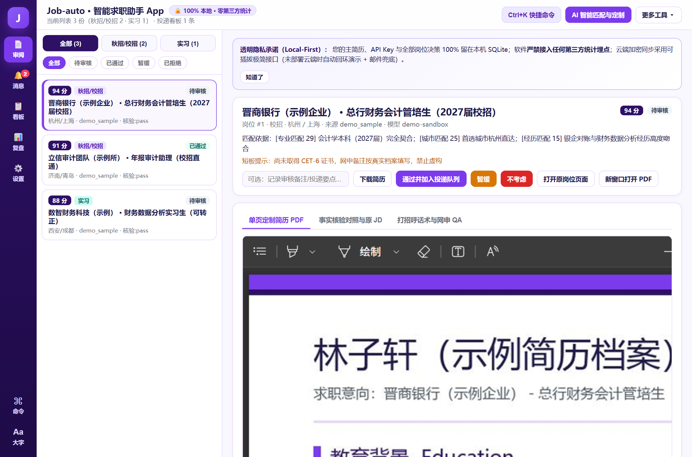
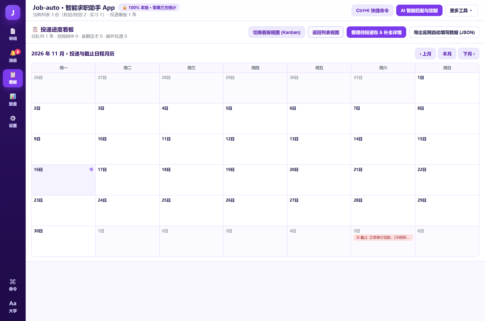
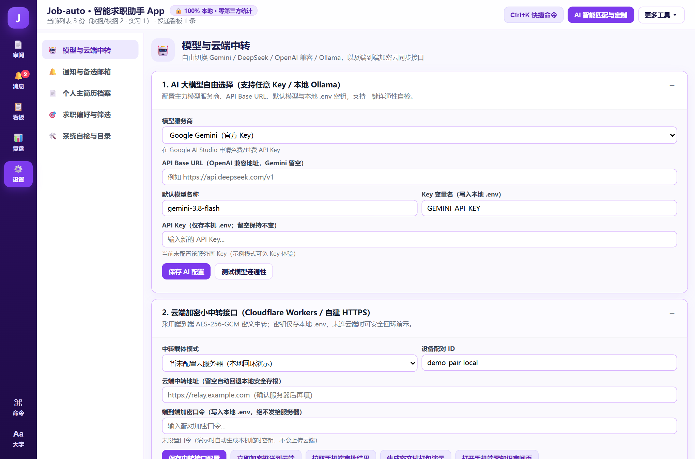
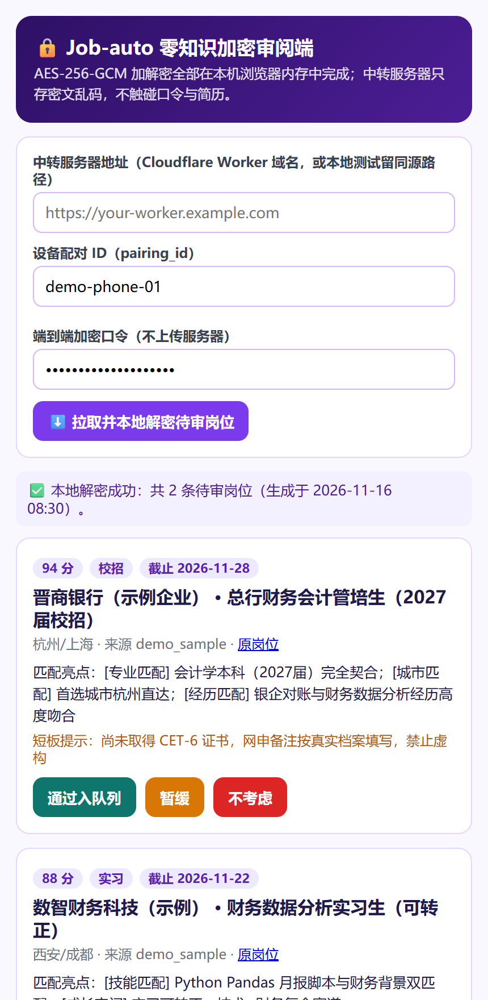

<div align="center">
  
  <h1>Job-auto · Local-First AI Job Search Desktop App</h1>
  <p>
    <strong>100% Local Privacy · Fact-Checked Tailored Resumes · One-Page PDF per Role · Zero-Knowledge E2EE Mobile Review</strong>
  </p>
  <p>
    
    
    
    
    
  </p>
  <p>
    <a href="README.md">简体中文</a> | <strong>English</strong>
  </p>
</div>

---

**Job-auto** is a standalone **Windows Desktop Application** built for campus recruiting and internship applications. It brings **job collection -> AI fit scoring -> single-page tailored resume PDF generation -> human-in-the-loop review -> application Kanban & deadline calendar -> browser autofill assistance** into one responsive, low-distraction workbench while staying strictly **Local-First**: your master resume profile, API keys, SQLite database, and generated PDFs never leave your machine, with zero third-party analytics or telemetry.

## Table of Contents

- [Key Features](#key-features)
- [Interface Showcase](#interface-showcase)
- [Quick Start (Zero-Setup Windows `.exe`)](#quick-start-zero-setup-windows-exe)
- [Detailed Usage Guide](#detailed-usage-guide)
- [Zero-Knowledge Mobile Review via Cloudflare Worker](#zero-knowledge-mobile-review-via-cloudflare-worker)
- [CLI Reference](#cli-reference)
- [Project Structure & Privacy Isolation](#project-structure--privacy-isolation)

---

## Key Features

1. **Five Dedicated Workspaces (Slim Rail Navigation)**
   - **`Review`**: Filter roles by track (`All` / `Campus` / `Intern`) and decision state (`Pending` / `Approved` / `Later` / `Rejected`). View transparent match breakdowns (`reasons`), gap warnings (`gaps`), an embedded single-page tailored PDF preview, fact-check diffs against the original JD, and ready-to-copy greeting/QA talking points.
   - **`Inbox`**: Full-width compact notification strip and system tray alerts with **App-first + desktop/mobile push priority** and automatic email fallback on failure (`auto_fallback_to_email`).
   - **`Queue & Calendar`**: Toggle seamlessly between full-width list rows, a 4-column **Kanban** board, and a **Monthly Deadline Calendar View**, plus one-click export for browser autofill bundles.
   - **`Insights`**: Application funnel metrics, upcoming deadline countdowns, and weekly review summaries.
   - **`Settings`**: Left-sidebar accordion panel to configure LLM providers, Cloudflare Worker E2EE relay, notification channels, master resume import, job preferences, and system health diagnostics.

2. **Flexible Model Routing & Zero-Hallucination Fact Checking**
   - Freely switch between **Google Gemini**, **DeepSeek / OpenAI-compatible APIs**, and **local Ollama**.
   - Every tailored resume bullet is grounded strictly against facts from your master profile and explicitly flags missing credentials/gaps without fabricating scores, dates, or certifications.
   - **Zero-Key Guest Demo Mode**: New users without an API key yet can load the built-in sanitized demo workspace (`seed-demo`) to try the full review, calendar, and E2EE relay loop immediately.

3. **Companion Browser Extension (`v1.3.0`) · Capture & Autofill (Never Auto-Submit)**
   - The bundled Edge/Chrome extension (`extensions/job_auto_collector/`) captures job listings from Boss Zhipin, Zhilian, 51Job, iGuopin, and Shixiseng directly to your local workbench (`127.0.0.1:8788`).
   - During portal applications, it fills approved profile fields and opening messages for you—**strictly autofill-only, never auto-submitting**, keeping final review and click confirmation in your hands.

4. **Zero-Knowledge Mobile Review via Cloudflare Worker (`AES-256-GCM`)**
   - When away from your desk, the desktop client encrypts pending review batches locally with `AES-256-GCM` (`pairing_id` bound as AAD) and pushes ciphertext envelopes to your self-hosted Cloudflare Worker KV (`RELAY_KV`). Open `/mobile` on your phone, enter your local passphrase to decrypt and approve/defer in browser memory, and pull decisions back into your desktop queue—the relay server sees only ciphertext.

5. **Desktop Polish**
   - `Ctrl + K` global command palette, `120%` Care Font accessibility mode, `0.8s` optimistic cached splash screen, and Windows system tray integration.

---

## Interface Showcase

<table>
  <tr>
    <td width="50%" align="center">
      <br/>
      <sub><strong>1. Review Workbench:</strong> Match evidence, gap alerts, approval actions & embedded 1-page PDF</sub>
    </td>
    <td width="50%" align="center">
      <br/>
      <sub><strong>2. Queue & Calendar:</strong> Full-width list, 4-column Kanban & monthly deadline calendar</sub>
    </td>
  </tr>
  <tr>
    <td width="50%" align="center">
      <br/>
      <sub><strong>3. Settings Center:</strong> Gemini / DeepSeek / Ollama switching & E2EE cloud relay config</sub>
    </td>
    <td width="50%" align="center">
      <br/>
      <sub><strong>4. E2EE Mobile Reviewer:</strong> Browser WebCrypto decryption & instant approve/defer/reject</sub>
    </td>
  </tr>
</table>

---

## Quick Start (Zero-Setup Windows `.exe`)

> **No Python, no Node.js, and no `.bat` scripts required** — both the Electron desktop shell and the local FastAPI/AI backend engine are bundled inside a single Windows release executable.

1. Go to the **[GitHub Releases](https://github.com/LI-11230930/Job-auto/releases)** page and download the latest Windows package (you can verify integrity against `SHA256SUMS.txt` on the same release):
   - **`Job-auto Setup 1.8.0.exe`**: Standard Windows installer wizard with Desktop / Start Menu shortcuts.
   - **`Job-auto 1.8.0.exe`**: Single-file Portable executable — **double-click and run**; user data is stored neatly beside the executable in `Job-auto-Data`.
2. On first launch without an API key, click **"载入示例体验数据"** (Load Demo Data) on the review screen to explore every feature immediately.

<details>
<summary>Developer Mode: Run from Source & Build Windows Installers</summary>

- Requirements: **Python 3.12+**, **Node.js 20+**
```bash
git clone https://github.com/LI-11230930/Job-auto.git
cd Job-auto
```
For local Windows development, launch `start.bat` (initializes `.venv` automatically and starts the Electron dev shell). To rebuild the full zero-dependency `.exe` locally:
```bash
python desktop/build_backend.py
cd desktop && npm install && npx electron-builder --win portable nsis --publish never
```

</details>

---

## Detailed Usage Guide

### Step 1: Import Your Master Resume & Configure Models (`Settings`)

1. Open **Settings** from the left rail:
   - **AI Model & Cloud Relay**: Choose a provider (`Google Gemini`, `DeepSeek`, or `Ollama`), enter your API key (written strictly to local `.env`, never tracked by Git), and click **Test Connectivity**.
   - **Master Resume Profile**: Upload or paste your `.txt` / `.md` / `.pdf` / `.docx` master resume to build the verified fact baseline and application QA bank.
   - **Preferences & Filtering**: Configure target job keywords, preferred cities, exclusion keywords, and minimum score threshold.

### Step 2: Collect Job Listings

1. **Load the Companion Browser Extension**:
   - Open Microsoft Edge -> navigate to `edge://extensions` -> enable **Developer mode**.
   - Click **Load unpacked** and select `resources/extensions/job_auto_collector/` inside your installed app folder (or `extensions/job_auto_collector/` in the source tree).
2. **Capture Listings**:
   - Use **More Tools -> Launch Collector Browser (9222)** or click the extension icon while browsing supported job boards to push structured listings into the local workbench, or sync configured campus/public sources.

### Step 3: Run AI Matching & Single-Page PDF Tailoring

- Click **AI 智能匹配与定制** in the top bar (or run `job-agent run-stage2`) to pre-filter new listings, score fit dimensions, render tailored single-page A4 PDFs, and prepare opening greetings.

### Step 4: Review & Track Applications (`Review` & `Queue`)

1. **Review**: Inspect match evidence, gap prompts, and the rendered PDF, then choose **Approve to Queue**, **Later**, or **Reject**.
2. **Queue & Calendar**: Track progress across list rows, the 4-column Kanban board, and the monthly deadline calendar, then open the target portal and use extension autofill before manually submitting.

---

## Zero-Knowledge Mobile Review via Cloudflare Worker

The repository includes a ready-to-deploy relay worker under `deploy/cloudflare-worker/`:

1. Follow [deploy/cloudflare-worker/README.md](deploy/cloudflare-worker/README.md) to deploy `worker.js` with a bound KV namespace named **`RELAY_KV`**.
2. In Desktop **Settings -> Cloud Relay**:
   - Set **Provider** to `Cloudflare Workers + KV/D1`
   - Set **Pairing ID** (e.g., `my-phone-01`)
   - Set **Relay Endpoint URL** (e.g., `https://your-relay.workers.dev`)
   - Set your **E2EE Passphrase** (stored only in local `.env`, never sent to the Worker)
3. Click **Push Encrypted Batch**, visit `https://your-relay.workers.dev/mobile` on your phone, enter your Pairing ID & passphrase to decrypt and triage locally in the browser, then click **Pull Mobile Decisions** back on desktop.

---

## CLI Reference

With the Python package installed (`python -m job_agent.cli <subcommand>`):

| Command | Description |
| --- | --- |
| `job-agent doctor` | Check workspace paths, config, browser binary, and LLM readiness |
| `job-agent setup` | Initialize local workspace directories and copy `.example` config templates |
| `job-agent up` (or `start`) | Start the local FastAPI workbench & collector receiver (`--app` / `--port`) |
| `job-agent collect-browser` | Collect listings via controlled browser session |
| `job-agent prefilter` | Run rule-based filtering and deduplication on new jobs |
| `job-agent run-stage2` | Run AI match scoring and single-page tailored PDF rendering |
| `job-agent sync-campus` / `sync-public` | Sync configured campus or public job sources |
| `job-agent reminders` / `weekly-report` | Check upcoming deadlines and generate weekly analytics |

---

## Project Structure & Privacy Isolation

```text
Job-auto/
├── Job-auto/                   # Core Python backend (sources, Stage 1-5 pipeline, FastAPI & UI)
├── desktop/                    # Electron desktop shell, tray, splash, icons & PyInstaller/NSIS builders
│   ├── assets/                 # App icons (icon.png / icon.ico / icon.svg)
│   ├── main.js / preload.js / splash.html / build_backend.py
│   └── package.json            # electron-builder Windows portable & NSIS config
├── extensions/
│   └── job_auto_collector/     # Edge/Chrome companion extension (v1.3.0: capture + autofill)
├── deploy/
│   └── cloudflare-worker/      # Cloudflare Workers zero-knowledge relay script & deploy guide
├── config/                     # Sanitized template configs only (user_config.example.yaml / extensions.example.yaml)
├── prompts/                    # System prompts & JSON schemas for JD split, scoring, and resume tailoring
├── scripts/                    # Developer helper scripts (not needed for .exe release users)
├── tests/                      # Automated test suite (pytest + FastAPI + E2EE cross-runtime tests)
├── .github/workflows/          # GitHub Actions CI & v* release build workflow (release.yml)
├── start.bat                   # Local Windows source dev launcher (not needed for .exe users)
├── pyproject.toml              # Python project metadata & dependencies
└── .env.example                # Local environment variable template
```

### Privacy Isolation (`.gitignore` Guarantees)

All personal profiles, credentials, and runtime outputs are strictly excluded from Git tracking:
- Private configs & secrets: `.env`, `config/user_config.yaml`, `config/extensions.yaml`
- Personal master resumes, certificates & generated files: `vault/`, `data/`, `output/`, `logs/`, `*.db`, `*.pdf`
- Build artifacts & local scratch data: `local/`, `desktop/dist/`, `desktop/node_modules/`, `desktop/backend-bin/`, `desktop/build-pyinstaller/`

---

## License

Released under the [MIT License](LICENSE).
