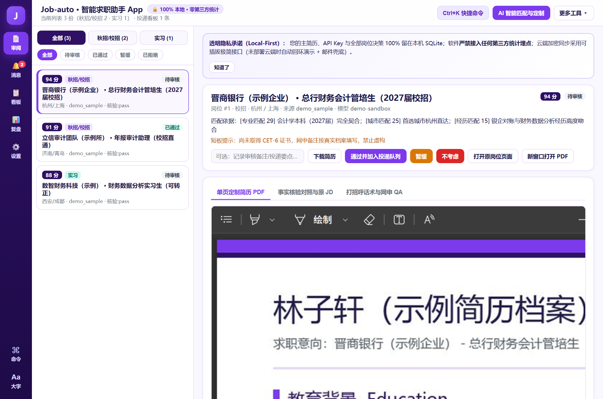
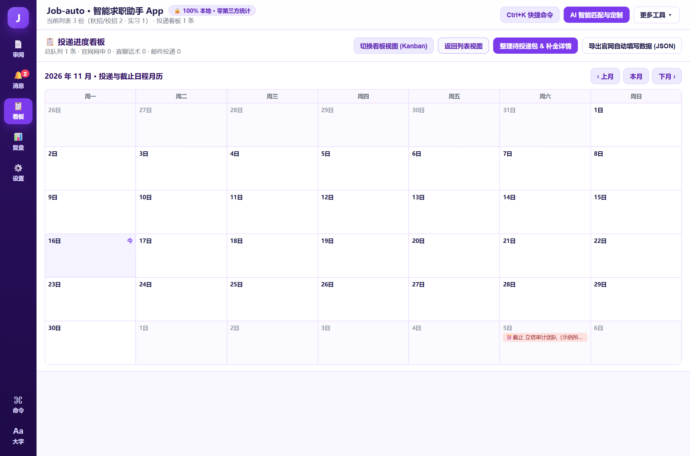
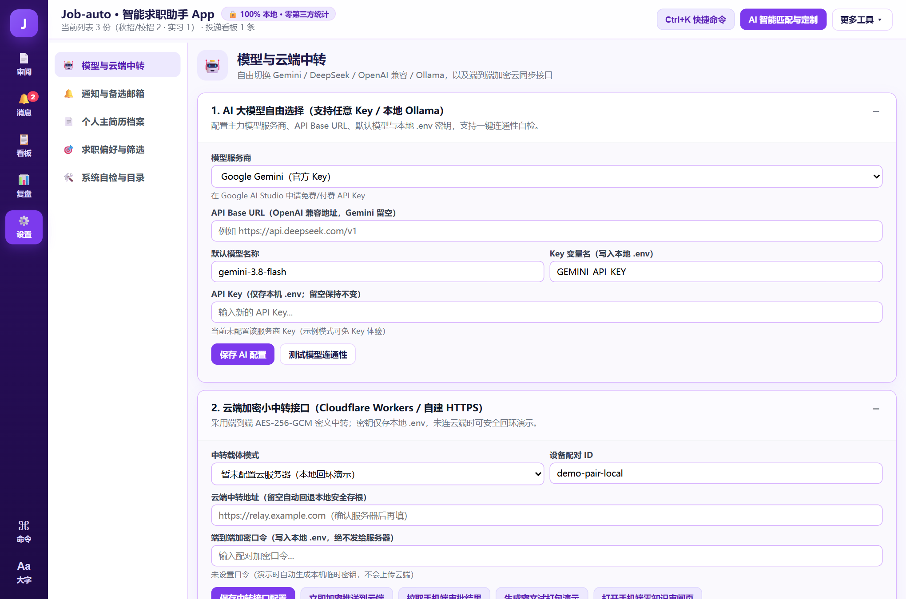
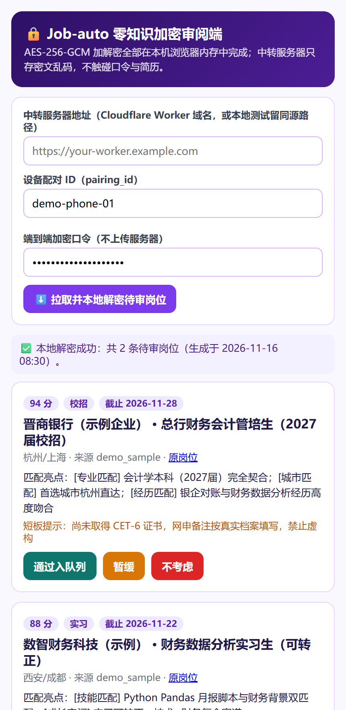

<div align="center">
  
  <h1>Job-auto · 本地优先的智能求职桌面助手 App</h1>
  <p>
    <strong>100% 本地隐私优先 · 零幻觉事实核验 · 一岗一页定制简历 · 端到端加密云中转手机审阅</strong>
  </p>
  <p>
    
    
    
    
    
  </p>
  <p>
    <strong>简体中文</strong> | <a href="README.en.md">English</a>
  </p>
</div>

---

**Job-auto** 是一款面向校招、秋招与实习求职场景的 **独立桌面应用（Windows Desktop App）**。它将「**岗位采集 -> 智能匹配评分 -> 单页定制简历 PDF 生成 -> 人工逐条审阅把关 -> 投递进度看板 & 截止日程日历 -> 浏览器辅助预填**」整合在一个高响应、低打扰的桌面工作台中，并坚持 **Local-First（本地优先）**：你的主简历档案、API 密钥、SQLite 岗位库和定制 PDF 全部留在自己电脑，软件不接入任何第三方统计埋点。

## 目录

- [核心特性](#核心特性)
- [界面与功能一览](#界面与功能一览)
- [快速开始（零环境 `.exe` 开箱即用）](#快速开始零环境-exe-开箱即用)
- [详尽使用指南](#详尽使用指南)
- [Cloudflare Worker 零知识手机审阅配置](#cloudflare-worker-零知识手机审阅配置)
- [常用命令行工具（CLI）](#常用命令行工具cli)
- [目录结构与隐私隔离说明](#目录结构与隐私隔离说明)

---

## 核心特性

1. **五大独立工作区（Slim Rail 极简导航）**
   - **`📄 审阅`（Workbench）**：左侧按批次（全部 / 秋招校招 / 实习）与状态（待审核 / 已通过 / 暂缓 / 已拒绝）筛选；右侧集中展示匹配得分拆解（`reasons`）、硬条件/短板提示（`gaps`）、内嵌单页定制简历 PDF 预览、事实核验对照与网申首句话术 QA。
   - **`🔔 消息`（Inbox）**：全宽紧凑消息中心与桌面托盘通知，支持 **App 消息中心 + 桌面/手机推送优先，异常自动回退邮件提醒**。
   - **`📋 看板`（Queue & Calendar）**：全宽投递进度列表、四列状态看板（待投递 / 已投递 / 笔试面试 / Offer 或归档）与 **月度截止日程日历视图** 一键切换，并可导出官网自动预填数据包。
   - **`📊 复盘`（Insights）**：投递转化漏斗、近期截止预警和周报复盘。
   - **`⚙️ 设置`（Settings）**：可视化配置大模型、云端零知识加密中转、通知策略、主简历档案导入、求职偏好以及系统连通性自检。
2. **多模型自由切换 · 严格事实核验（零虚构）**
   - 支持 **Google Gemini**、**DeepSeek / OpenAI 兼容接口** 与 **本地 Ollama** 自由切换。
   - 内置事实锚点核验约束：针对不同岗位自动重排亮点、生成专属一页式 PDF，但不虚构未获得的证书、成绩或实习经历。
   - **零 Key 访客示例体验**：首次打开暂无 API Key 时，可一键载入内置脱敏示例数据（`seed-demo`），完整体验审阅、看板日历与加密中转全流程。
3. **浏览器伴侣扩展（`v1.3.0`）· 辅助采集 + 网申预填（不代提交）**
   - 配套 Edge / Chrome 扩展（`extensions/job_auto_collector/`）支持在 Boss 直聘、智联招聘、前程无忧、国聘网、实习僧等页面辅助采集岗位到本地桌面端（`127.0.0.1:8788`）。
   - 网申时支持读取待投递包一键填入基础字段与打招呼话术，**严格遵守「辅助预填、绝不代点提交（Autofill Only · Never Auto-Submit）」**，最终核对与提交始终由你本人确认。
4. **Cloudflare Worker 零知识手机加密审阅（AES-256-GCM）**
   - 外出不在电脑前时，桌面端通过 `AES-256-GCM` 在本地加密待审岗位并推送到自部署的 Cloudflare Worker（KV 暂存密文）；手机浏览器打开 `/mobile` 页面输入本地口令在浏览器内存中实时解密审批，结果回传后由桌面端自动同步入投递看板。中转服务器全程只见密文，无法窥探简历或审批内容。
5. **桌面体验细节打磨**
   - 支持 `Ctrl + K` 全局快捷命令面板、`120% 舒心大字` 模式、0.8s 乐观缓存闪屏启动、Windows 系统托盘常驻与通知提醒。

---

## 界面与功能一览

<table>
  <tr>
    <td width="50%" align="center">
      <br/>
      <sub><strong>1. 审阅工作台（Review）：</strong>匹配依据、风险提示、审核决策与内嵌单页 PDF 预览</sub>
    </td>
    <td width="50%" align="center">
      <br/>
      <sub><strong>2. 投递看板（Queue）：</strong>支持列表、四列看板（Kanban）与月度截止日历视图</sub>
    </td>
  </tr>
  <tr>
    <td width="50%" align="center">
      <br/>
      <sub><strong>3. 设置中心（Settings）：</strong>支持 Gemini / DeepSeek / Ollama 与云中转配置</sub>
    </td>
    <td width="50%" align="center">
      <br/>
      <sub><strong>4. 零知识手机审阅端：</strong>浏览器端 WebCrypto 实时解密、快捷通过/暂缓/拒绝</sub>
    </td>
  </tr>
</table>

---

## 快速开始（零环境 `.exe` 开箱即用）

> **无需安装 Python、Node.js，也无需任何命令行或 `.bat` 脚本**——桌面客户端与本地 AI 后端引擎已完整封装进单一 Windows `.exe` 安装包。

1. 前往本仓库的 **[GitHub Releases](https://github.com/LI-11230930/Job-auto/releases)** 下载最新版本（可对照同页面的 `SHA256SUMS.txt` 校验文件完整性）：
   - **`Job-auto Setup 1.8.0.exe`**：标准 Windows 安装向导，安装后直接通过桌面 / 开始菜单图标启动；
   - **`Job-auto 1.8.0.exe`**：单文件便携版（Portable），**双击即开即用**，所有个人数据与配置存放在同目录下的 `Job-auto-Data` 文件夹中，不污染系统。
2. 首次打开若尚未准备 API Key，可直接在审阅页点击 **「载入示例体验数据」**，完整体验单页简历、月度看板与零知识加密审阅全流程。

<details>
<summary>开发者模式：从源码本地调试与构建安装包</summary>

- 环境要求：**Python 3.12+**、**Node.js 20+**
```bash
git clone https://github.com/LI-11230930/Job-auto.git
cd Job-auto
```
Windows 本机开发调试可直接运行 `start.bat`（自动初始化 `.venv` 并以 Electron 源码模式启动）；如需本地重新打包完整独立 `.exe`，可执行：
```bash
python desktop/build_backend.py
cd desktop && npm install && npx electron-builder --win portable nsis --publish never
```

</details>

---

## 详尽使用指南

### 第一步：导入个人主简历与配置模型（设置页 `⚙️`）

1. 在桌面端左侧栏进入 **设置**：
   - **AI 模型与云中转**：选择服务商（如 `Google Gemini`、`DeepSeek` 或 `Ollama`），填入 API Key（点击保存后会安全写入本地根目录 `.env`，不会提交到版本库），点击「测试模型连通性」确认绿色通过。
   - **个人主简历档案**：支持直接上传/粘贴 `.txt` / `.md` / `.pdf` / `.docx` 个人主简历，系统会自动提取教育背景、经历事实条目与常见问题（QA）词库作为后续定制核验的唯一事实基线。
   - **求职偏好与筛选**：设置意向岗位关键词、目标城市、硬门槛过滤词与最低评分阈值。

### 第二步：多渠道采集岗位

1. **安装伴侣浏览器扩展**：
   - 打开 Edge 浏览器 -> 访问 `edge://extensions` -> 开启右下角/右上角「开发人员模式」；
   - 点击「加载解压缩的扩展」，选择安装目录 `resources/extensions/job_auto_collector/`（或源码仓库内的 `extensions/job_auto_collector/` 目录）。
2. **开始采岗**：
   - 在 Job-auto 顶栏「更多工具」点击「启动插件抓岗浏览器 (9222)」，或在你常使用的浏览器中浏览招聘网站搜索页/详情页，点击扩展图标即可自动解析并推送到本地工作区。
   - 也可使用公开校招源同步（`sync-campus` / `sync-public`）或手动导入单条 JD / 长招聘贴。

### 第三步：AI 匹配评分与一页式简历生成

- 点击顶部紫色的 **「AI 智能匹配与定制」**（或命令行运行 `run-stage2`），系统会自动对入库的新岗位完成初筛（`prefilter`）、多维评分（`reasons` / `gaps`）、一页式 A4 PDF 渲染以及网申首句打招呼话术准备。

### 第四步：在「审阅」与「看板」推进投递

1. **审阅工作台（`📄 审阅`）**：
   - 对每条推荐岗位查看匹配理由、差距风险提示与生成的单页简历预览；
   - 确认无误后点击 **「通过并加入投递队列」**，或选择「暂缓 / 不考虑」；也可切换至「事实核验对照与原 JD」和「打招呼话术与网申 QA」快速复制要点。
2. **投递看板（`📋 看板`）**：
   - 使用 **列表视图**、**四列 Kanban 拖拽/状态流转** 或 **月度日历视图** 跟进每家企业的网申状态与网申截止日期；
   - 点击 **「打开原岗位页面」** 后配合扩展插件填入已审核通过的个人资料与话术，自行复核无误后再手动提交。

---

## Cloudflare Worker 零知识手机审阅配置

仓库内 `deploy/cloudflare-worker/` 提供了零知识中转服务端源码，可一键部署到个人 Cloudflare 免费额度账号：

1. 按照 [deploy/cloudflare-worker/README.md](deploy/cloudflare-worker/README.md) 的说明部署 `worker.js`，并绑定 KV 命名空间 **`RELAY_KV`**。
2. 在桌面 App 的 **「设置 -> 模型与云端中转 -> 云端加密小中转接口」** 中：
   - **中转载体模式**：选择 `Cloudflare Workers + KV/D1`
   - **设备配对 ID**：自定义配对标识（如 `my-phone-01`）
   - **云端中转地址**：填入你的 Worker 域名（例如 `https://your-relay.workers.dev`）
   - **端到端加密口令**：设置仅本地保存的强口令（写入本地 `.env`，绝不发送至服务器）
3. 点击 **「立即加密推送到云端」**，即可用手机浏览器访问你的 Worker 域名下的 `/mobile`（或本地同源 `/relay-mobile`），输入配对 ID 与同一口令即可本地解密审阅，审阅完毕点击回传后桌面端点击 **「拉取手机端审批结果」** 自动入队。

> **安全边界提示**：桌面端与手机浏览器均基于标准 WebCrypto / Python cryptography 的 `AES-256-GCM` 对整批报文进行认证加密，且 `pairing_id` 作为 AAD 参与校验。Worker KV 仅作为匿名密文信箱使用，建议避免将其作为公共开放接口，并妥善保管你的配对 ID 与口令。

---

## 常用命令行工具（CLI）

在激活 `.venv` 后，可直接通过 `python -m job_agent.cli <subcommand>` 执行全部核心管线动作：

| 命令 | 说明 |
| --- | --- |
| `job-agent doctor` | 运行环境、配置、浏览器与大模型连通性自检 |
| `job-agent setup` | 初始化本地目录并复制示例配置（`config/*.example.yaml`、`.env.example`） |
| `job-agent up`（或 `start`） | 启动本地 Web/App 服务（支持 `--app` / `--port`） |
| `job-agent collect-browser` | 配合浏览器采集当前页面或搜索结果 |
| `job-agent prefilter` | 对新入库岗位执行规则初筛与去重 |
| `job-agent run-stage2` | 执行 AI 匹配评估与定制单页简历 PDF 生成 |
| `job-agent sync-campus` / `sync-public` | 同步配置好的校招或公开岗位数据源 |
| `job-agent reminders` / `weekly-report` | 检查临近截止岗位并生成本周复盘周报 |

---

## 目录结构与隐私隔离说明

```text
Job-auto/
├── Job-auto/                   # Python 核心引擎包（采集、Stage1/2/3/4、AI 调度、Web 服务与 UI）
├── desktop/                    # Electron 桌面壳、系统托盘、闪屏页、图标资源与打包配置
│   ├── assets/                 # App 图标（icon.png / icon.ico / icon.svg）
│   ├── main.js / preload.js / splash.html / build_backend.py
│   └── package.json            # electron-builder Windows portable & NSIS 打包定义
├── extensions/
│   └── job_auto_collector/     # Edge/Chrome 伴侣扩展（v1.3.0：采岗采集 + 辅助预填）
├── deploy/
│   └── cloudflare-worker/      # Cloudflare Workers 零知识加密中转脚本与部署指南
├── config/                     # 仅包含脱敏示例配置（user_config.example.yaml / extensions.example.yaml）
├── prompts/                    # 岗位匹配、简历定制与信息提取的系统提示词模板
├── scripts/                    # 开发者本地调试辅助脚本（Releases 安装包用户无需使用）
├── tests/                      # 自动化测试套件（pytest + FastAPI + E2EE 端到端测试）
├── .github/workflows/          # GitHub Actions 自动化测试与 v* 标签发布流水线（release.yml）
├── start.bat                   # Windows 本地源码一键调试入口（Releases 安装包用户无需使用）
├── pyproject.toml              # Python 项目元数据与依赖清单
└── .env.example                # 本地环境变量示例模板
```

### 隐私安全承诺（默认 Git 隔离）

仓库的 `.gitignore` 严格屏蔽了所有个人与敏感运行数据，包括但不限于：
- 真实个人配置文件与密钥：`.env`、`config/user_config.yaml`、`config/extensions.yaml`
- 个人主简历、证书扫描件与输出成品：`vault/`、`data/`、`output/`、`logs/`、`*.db`、`*.pdf`
- 仅本地维护的内部草稿与构建产物：`local/`、`desktop/dist/`、`desktop/node_modules/`

---

## 开源协议

本项目基于 [MIT License](LICENSE) 开源。
